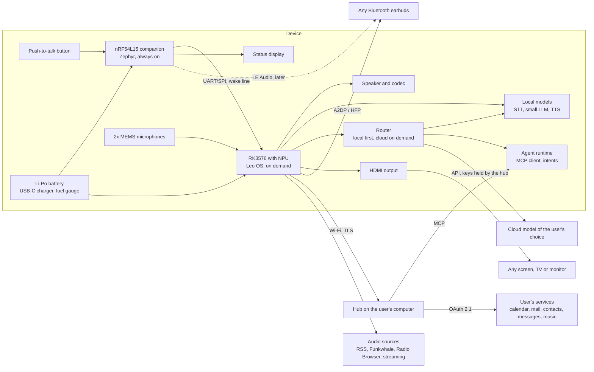

# Architecture

Status: design, not yet built. Every statement below is a design decision or a plan,
not a measurement. Measurements are published in `bring-up.md` and under `hardware/`.

## Block diagram

## The two-chip split

The device has two processors with different jobs.

- The nRF54L15 is always on. It owns the button, the battery, the status display, the
  power rails and the wake of the SoC. It must run for days on the battery while the
  SoC sleeps. It runs Zephyr.
- The SoC runs Leo OS. It wakes on button press, handles audio, the local models, the
  router, the agent, playback and the connection to the hub, then goes back to sleep.
  When a screen is plugged in, the device is powered by the cable, the SoC stays on
  and runs the viewing session. Target wake
  time from button press to microphone open: under one second. This is the first thing
  WP1 measures; if suspend-to-RAM resume is too slow, a lighter standby state is the
  fallback.

SoC: Rockchip RK3576 (NPU with a vendor runtime, HDMI output, mainline Linux work in
progress), with the Luckfox Core3576 development module for the first prototype. Two alternatives are
followed in case the measurements rule it out: Axera AX630C (lowest power, smallest
NPU, no display output known) and Qualcomm QCS6490 (strongest NPU, higher power,
harder sourcing). WP1 measures power in idle and in inference, tokens per second and
wake time on the same run, and the data is published.

Handshake between the chips: a wake line plus UART (or SPI) with a small framed
protocol: button events, battery state, display content from the SoC to the companion,
playback control from the companion to the SoC.

## Leo OS

Leo OS is the system image for the SoC. It is a Linux distribution built from open
components, with the voice agent as the primary interface.

- Base: a minimal Linux image built with a reproducible tool (Buildroot or Yocto,
  decided in WP1), read-only root, signed over-the-air updates,
  software bill of materials. These are also the obligations of the EU Cyber
  Resilience Act for connected products from December 2027.
- Audio: PipeWire and BlueZ (A2DP and HFP to earbuds), ALSA for the on-board codec,
  echo cancellation for the speaker.
- Local models: a speech-to-text engine (Whisper tiny or base, or a successor),
  a language model under 1B parameters quantised for the NPU (Qwen3-0.6B and LFM2-700M
  are the first candidates), and a text-to-speech engine (Piper). All exposed through
  the Wyoming protocol so any of them can be swapped by the user.
- Router: every request goes first to the local model. The local model answers
  directly, calls a tool, or decides that the request needs the cloud model. Rules
  the user can set on the hub: never cloud, cloud only on Wi-Fi, cloud for specific
  tools. The cloud model is any model with an API: Claude, an open model on the
  user's own server, or others. The device never holds the cloud keys; the hub does.
- Agent runtime: the loop that turns a transcript into tool calls and a spoken answer.
  Tools come from the hub over MCP (Model Context Protocol): calendar, mail,
  contacts, messages, music, and anything the user adds on the hub.
- Playback: podcasts by RSS, radio from Radio Browser, music from the user's own
  library, Funkwhale or a streaming service the user authorises on the hub.
- Viewing session (screen mode, step 1): when a screen is connected by HDMI (video
  over USB-C is an alternative under evaluation), Leo OS starts a minimal Wayland session with one full-screen browser window
  that shows what the agent generated: a web page, a document, the transcript, what is
  playing. Voice stays the interface; a keyboard is optional. Screen mode is powered by
  the cable: a comparable board with the same SoC family draws about 2.7 W idle with a
  desktop open (published measurement of a Radxa ROCK 4D, whole board, no monitor),
  which no pocket battery and no 48 C surface limit can carry. Power with HDMI video
  active is not verified. Step 2, a conventional desktop for keyboard and mouse, is a
  separate software project and is not decided.

## Data flows

### Push-to-talk

1. User presses the button. The companion wakes the SoC and ducks any playback.
2. While the button is held, the SoC records from the microphones (or from the earbuds
   over HFP) and streams audio to the speech-to-text engine: on the device by default,
   on the hub or remote if the user chose so.
3. On release, the transcript goes to the router. The local model answers simple
   requests and calls tools through the hub. Requests the local model marks as beyond
   its ability go to the cloud model the user configured, with the tools exposed to it
   through the hub.
4. The answer goes to the text-to-speech engine, the audio plays on the earbuds or the
   speaker, and playback resumes. An earcon under 200 ms confirms the request before
   the answer arrives.

Published in WP4: end-to-end time from button release to first spoken word, for the
local path and the cloud path, and the share of requests that stay local on a
60-sentence benchmark in Spanish and English.

### Pairing without keyboard or browser

1. The hub generates a pairing request and shows nothing secret on the device.
2. The device shows a QR code with its public key and a one-time code.
3. The user scans it with the hub (webcam or phone camera relaying to the hub).
4. The hub binds the device key and completes OAuth 2.1 with PKCE against each service.
5. Long-lived tokens and cloud model keys stay on the hub. The device holds only
   short-lived capability tokens for the hub itself. Revocation happens on the hub.

Threat model: `threat-model.md` (WP5).

### Playback

Podcasts, radio and music, controlled from the companion (next, pause, volume) without
waking the SoC for simple controls when the stream is already running. Bluetooth A2DP
to the earbuds, or the built-in speaker.

### External screen (viewing session)

1. User plugs an HDMI cable, with power on the cable (video over USB-C is the
   alternative under evaluation). The
   companion keeps the SoC awake and switches to the mains power regime.
2. Leo OS starts the viewing session: one full-screen window with what the agent
   generated. A voice command opens a page, a document or the transcript in it.
3. Unplugging the screen returns the device to pocket mode and the sleep policy.

Two power and thermal regimes on one board, and USB-C video (DisplayPort Alt Mode) on
Linux, are the open engineering questions of this mode. Proposed measurements: time to
first image, resolution, power and surface temperature in screen mode.

## Protocols and why

| Need | Choice | Reason |
|------|--------|--------|
| Speech in and out | Wyoming protocol | Used by Rhasspy, Home Assistant and OpenVoiceOS; lets the user swap engines |
| Local language model | Quantised sub-1B model on the NPU through the vendor runtime, behind an OpenAI-compatible local endpoint | Lets the router treat local and cloud models the same way |
| Local to cloud routing | A router on the device (LiteLLM or equivalent) with user rules held on the hub | One place for cost, privacy and connectivity rules |
| Hub to services | OAuth 2.1 with PKCE, RFC 8628 device flow where needed | Standard; tokens never on the device |
| Hub tool interface | Model Context Protocol (MCP) | One interface for calendar, contacts, mail, messages and music; any model the user chooses can call it |
| Earbuds | Bluetooth A2DP and HFP on BlueZ and PipeWire; LE Audio later via the nRF54L15 | Works with earbuds people already own |
| External screen | HDMI (DisplayPort over USB-C as an alternative under evaluation), minimal Wayland session with one full-screen browser | Standard cables, no dock; one window keeps the system small |
| Companion firmware | Zephyr | Nordic's supported RTOS; same path as ZSWatch |
| System image | Buildroot or Yocto, read-only root, signed updates, SBOM | Reproducible, small, meets Cyber Resilience Act obligations |
| Hardware design | KiCad | Free tool, CERN-OHL-S friendly |

## Open questions tracked as issues

- SoC confirmation: power in idle and in inference, tokens per second, wake time and display
  output on the same board.
- Suspend-to-RAM resume time on the vendor kernel versus mainline.
- Thermal budget of the SoC under sustained inference in a 50 g enclosure.
- HFP microphone quality (mSBC) versus the on-board microphones.
- Which requests the local model can answer alone, measured on the benchmark.
- Battery size versus enclosure volume.
- USB-C DisplayPort Alt Mode support on the chosen SoC and kernel.
- Power and temperature in screen mode with video active, on mains power.
