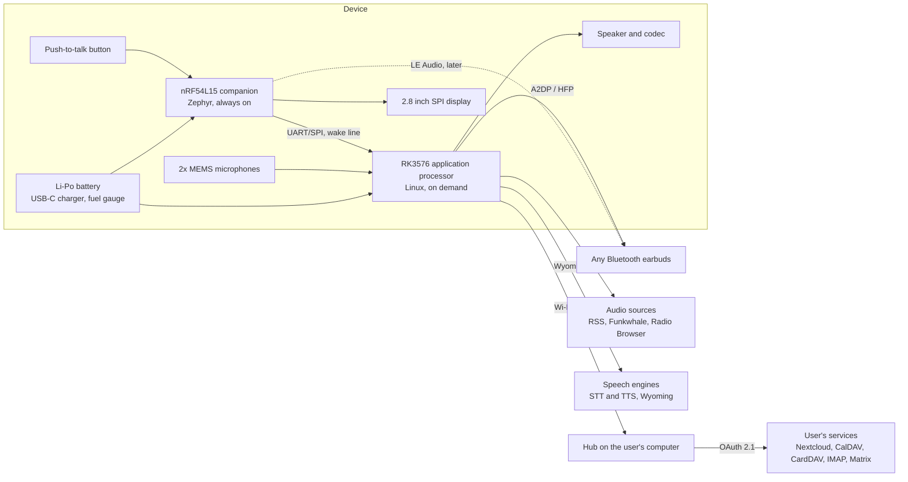

# Architecture

Status: design, not yet built. Every statement below is a design decision or a plan,
not a measurement. Measurements are published in `bring-up.md` and under `hardware/`.

## Block diagram

## The two-chip split

The device has two processors with different jobs.

- The nRF54L15 is always on. It owns the button, the battery, the display, the power
  rails and the wake of the RK3576. It must run for days on the battery while the
  RK3576 sleeps. It runs Zephyr.
- The RK3576 runs Linux. It wakes on button press, handles audio, playback, the speech
  satellite and the connection to the hub, then goes back to sleep. Target wake time
  from button press to microphone open: under one second. This is the first thing M1
  measures; if suspend-to-RAM resume is too slow, a lighter standby state is the fallback.

Handshake between the chips: a wake line plus UART (or SPI) with a small framed
protocol: button events, battery state, display content from the RK3576 to the
companion, playback control from the companion to the RK3576.

## Data flows

### Push-to-talk

1. User presses the button. The companion wakes the RK3576 and ducks any playback.
2. While the button is held, the RK3576 records from the microphones (or from the
   earbuds over HFP) and streams audio over the Wyoming protocol to the speech engine
   chosen by the user: on the device, on the hub, or on a remote open service.
3. On release, the transcript goes to the hub, which resolves the command against the
   user's services and returns text.
4. The text goes to the text-to-speech engine (Wyoming), the audio comes back and plays
   on the earbuds or the speaker. Playback resumes.

Published in M3: end-to-end time from button release to first spoken word, for each
placement of the speech engines.

### Pairing without keyboard or browser

1. The hub generates a pairing request and shows nothing secret on the device.
2. The device shows a QR code with its public key and a one-time code.
3. The user scans it with the hub (webcam or phone camera relaying to the hub).
4. The hub binds the device key and completes OAuth 2.1 with PKCE against each service.
5. Long-lived tokens stay on the hub. The device holds only short-lived capability
   tokens for the hub itself. Revocation happens on the hub.

Threat model: `threat-model.md` (M4).

### Playback

Podcasts by RSS, music from Funkwhale, radio from Radio Browser, controlled from the
companion (next, pause, volume) without waking the RK3576 for simple controls when the
stream is already running. Bluetooth A2DP to the earbuds, or the built-in speaker.

## Protocols and why

| Need | Choice | Reason |
|------|--------|--------|
| Speech in and out | Wyoming protocol | Used by Rhasspy, Home Assistant and OpenVoiceOS; lets the user swap engines; no model is bundled |
| Hub to services | OAuth 2.1 with PKCE | Standard, works with Nextcloud and Matrix; tokens never on the device |
| Hub tool interface | Model Context Protocol (MCP) | One interface for calendar, contacts, mail and messages; any assistant the user chooses can call it |
| Earbuds | Bluetooth A2DP and HFP on BlueZ and PipeWire; LE Audio later via the nRF54L15 | Works with earbuds people already own |
| Companion firmware | Zephyr | Nordic's supported RTOS; same path as ZSWatch |
| Hardware design | KiCad | Free tool, CERN-OHL-S friendly |

## Open questions tracked as issues

- RK3576 suspend-to-RAM resume time on the vendor kernel versus mainline.
- HFP microphone quality (mSBC) versus the on-board microphones.
- Display: SPI IPS under the RK3576, or e-paper under the companion.
- Battery size versus enclosure volume.
